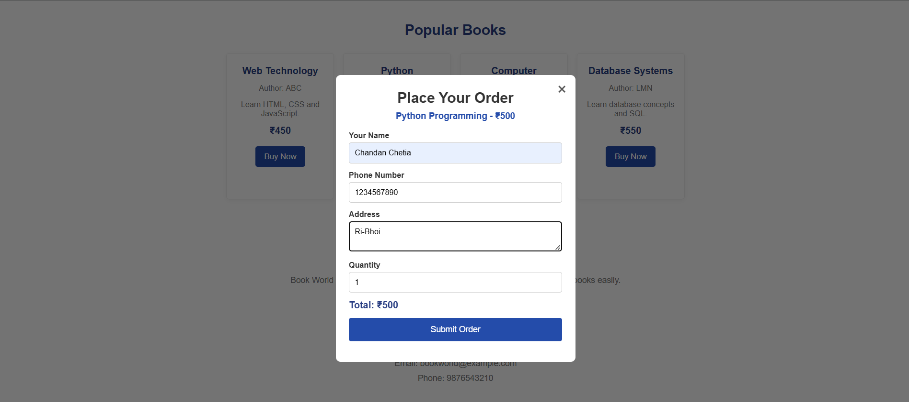
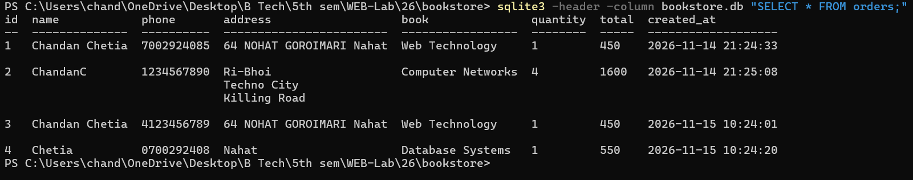

# Book World – Node.js + SQLite

A simple online book store. Click **Buy Now** on a book, fill the popup form, and the order is saved in a database.

## Screenshots

### Home page


### Order form (popup)


### Output — saved order / orders list


## Folder structure

```
bookstore/
├── server.js        ← Node server + SQLite database code
├── package.json     ← project info and dependencies
├── README.md        ← this file
└── public/
    ├── index.html   ← the website
    ├── style.css    ← the styles
    └── script.js    ← popup form logic
```

## 1. Requirements
```
cd 'c:/Users/chand/OneDrive/Desktop/B Tech/5th sem/WEB-Lab/26/bookstore'
```

- Node.js 18 or newer – check with `node -v` (download from https://nodejs.org)

## 2. Run the project

Open a terminal inside the `bookstore` folder:

```bash
npm install
npm start
```

You should see: `Server running at http://localhost:3000`

Open http://localhost:3000 in your browser. Press `Ctrl + C` to stop the server.

> Open the site through `http://localhost:3000`, not by double-clicking `index.html`, otherwise the form cannot reach the server.

## 3. Place an order

1. Click **Buy Now** on any book.
2. Fill in name, phone (10 digits), address and quantity.
3. Click **Submit Order**.

The order is saved in `bookstore.db` (created automatically on first run). The total price is calculated by the server.

## 4. See the database in the terminal

```
node view_data.js
```
or
```bash
sqlite3 -header -column bookstore.db "SELECT * FROM orders;"
```

## 5. Reset everything

Stop the server and delete `bookstore.db`. A new empty one is created on the next start.

## Adding or changing books

Book prices are listed in the `prices` object at the top of `server.js`. If you add a new book card in `index.html`, add the same book name and price there too.

## Troubleshooting

- **`npm` is not recognized** → install Node.js and reopen the terminal.
- **Port 3000 already in use** → close the other program or change `3000` at the bottom of `server.js`.
- **Form says "Something went wrong"** → make sure the server is running and you opened `http://localhost:3000`.
