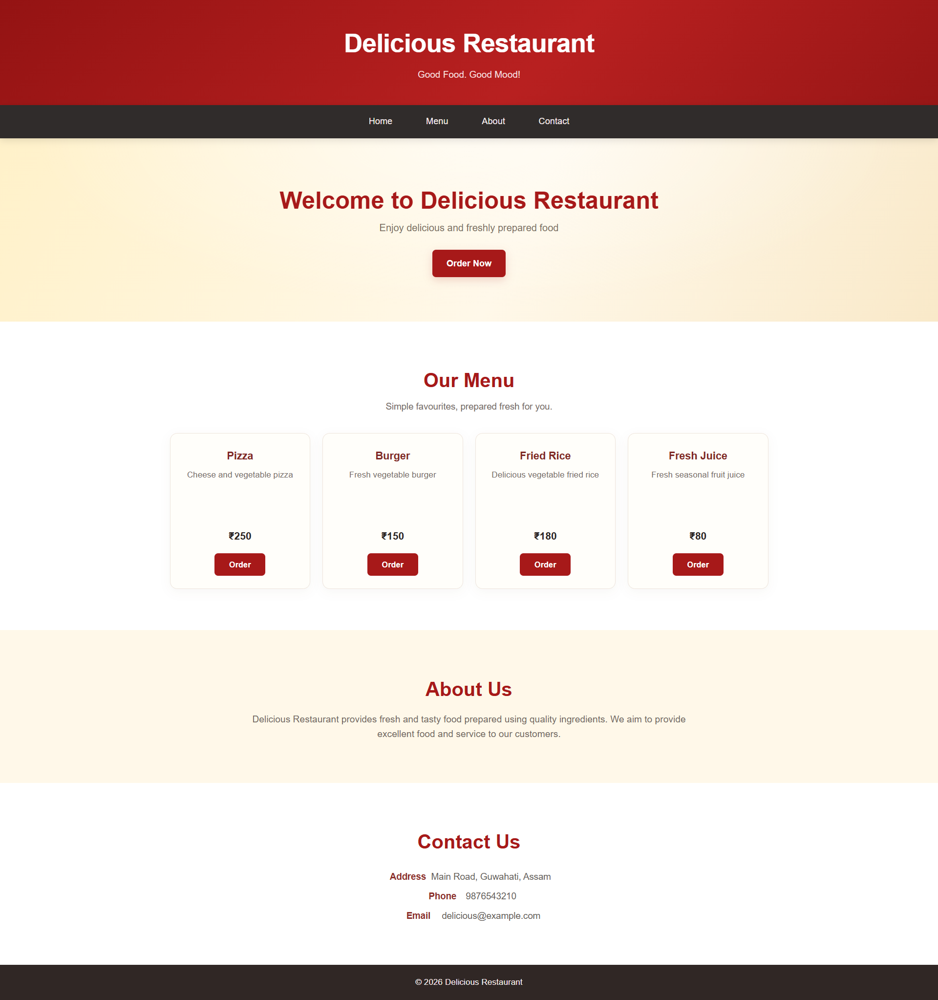
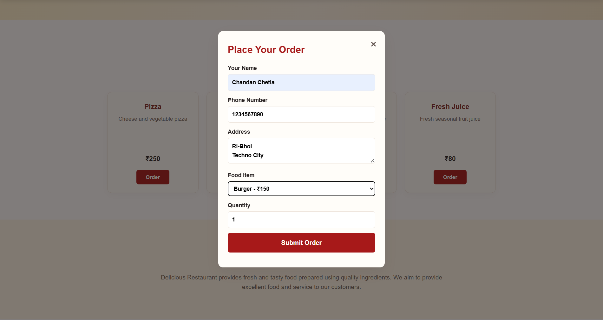
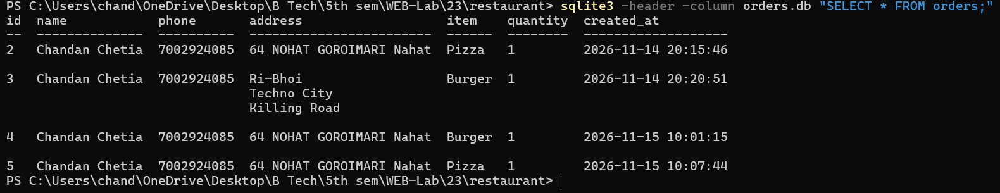

# Delicious Restaurant – Simple Order App

A beginner-level Node.js + SQLite project. Click **Order Now**, fill the popup form, and the order is saved in a database.

## Screenshots

### Home page


### Order form (popup)


### Output — saved order / orders list


## Folder structure

```
restaurant/
├── server.js        ← Node server + SQLite database code
├── package.json     ← project info and dependencies
├── README.md        ← this file
└── public/
    ├── index.html   ← the website
    ├── style.css    ← the styles
    └── script.js    ← popup form logic
```

## 1. Requirements

- Node.js (version 18 or newer) – check with `node -v`
- Download from https://nodejs.org if you don't have it

## 2. Run the project

```
cd 'c:/Users/chand/OneDrive/Desktop/B Tech/5th sem/WEB-Lab/23/restaurant'
```

Open a terminal inside the `restaurant` folder and run:

```bash
npm install
npm start
```

You should see: `Server running at http://localhost:3000`

Open http://localhost:3000 in your browser. Press `Ctrl + C` in the terminal to stop the server.

## 3. Place an order

1. Click **Order Now** (or the **Order** button on any food card).
2. Fill in name, phone (10 digits), address, food item and quantity.
3. Click **Submit Order**.

The order is saved in a file called `orders.db`, which is created automatically the first time you start the server.

## 4. See the database in the terminal

```
node view_data.js
```
or
```bash
sqlite3 -header -column orders.db "SELECT * FROM orders;"
```
## 5. Reset everything

To delete all orders, stop the server and delete the `orders.db` file. A fresh empty one is created next time you run `npm start`.

## Troubleshooting

- **`npm` is not recognized** → install Node.js and reopen the terminal.
- **Port 3000 already in use** → close the other program, or change `3000` at the bottom of `server.js`.
- **Page opens but the form says "Something went wrong"** → make sure the server is running and you opened the site through `http://localhost:3000`, not by double-clicking `index.html`.