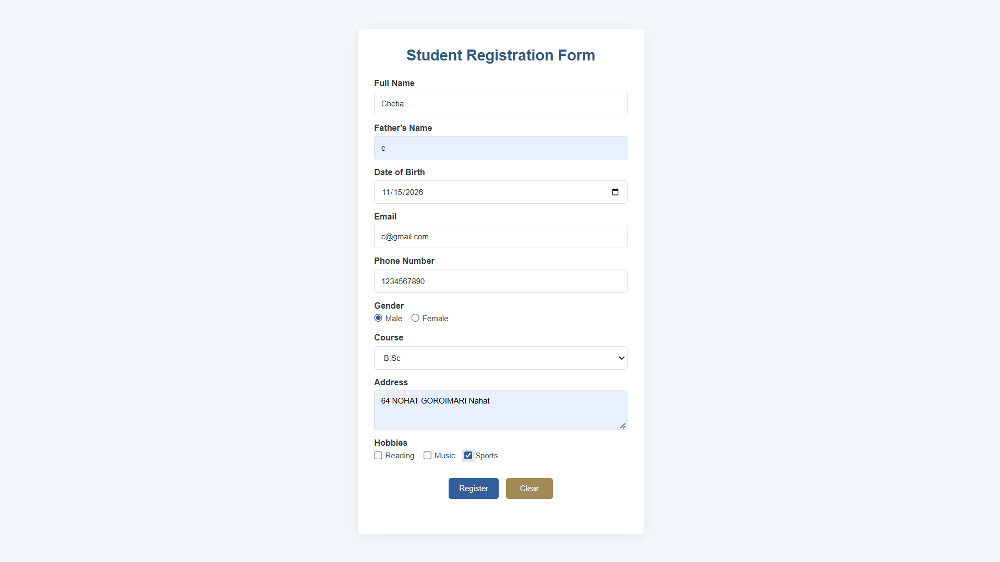
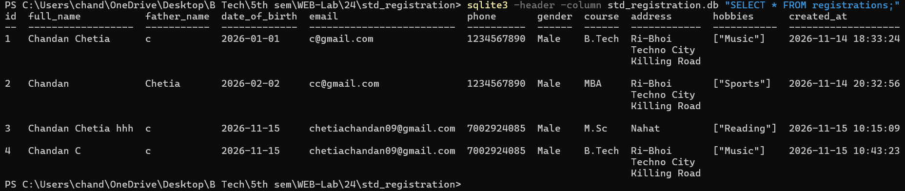

# Student Registration Form

A responsive student registration form built with HTML, CSS, JavaScript, Express, and SQLite.

## Screenshots

### Home page


### Output — saved order / orders list


## Run
Go to your path
```
cd 'c:/Users/chand/OneDrive/Desktop/B Tech/5th sem/WEB-Lab/24/std_registration'
```
From the project directory:

```powershell
npm install
npm start
```

Open `http://localhost:3000`. Registrations are saved in `std_registration.db` in the project directory. The server creates the database and `registrations` table on startup. Set `STD_REGISTRATION_DB_PATH` to use a different database file.

## View Database

From the project directory, run:
```
node view_data.js
```
or
```
sqlite3 -header -column std_registration.db "SELECT * FROM registrations;"
```
Use the form to submit registrations while the server is running. The server validates each submission before saving it.
